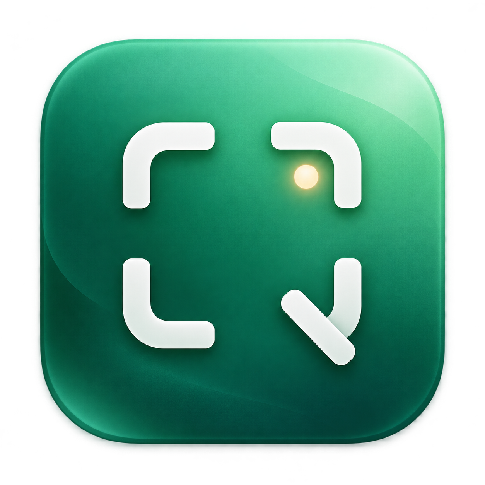

<p align="center"></p>
<h1 align="center">轻截图 QingShot</h1>
<p align="center">捕捉。标记。分享。原生 macOS 截图工具。</p>
<p align="center"><a href="../README.md">English</a> · 简体中文 · MIT</p>

SwiftUI + AppKit 开发预览版，要求 macOS 15+。没有第三方包依赖、遥测、联网或上传服务。

## 功能

- 区域、窗口、主屏截图；截图后悬浮操作条。
- 自定义全局快捷键，冲突提示、停用、恢复默认，自动保存。
- 箭头、矩形、椭圆、画笔、文字、序号、高亮、实色遮盖；裁剪、撤销与重做。
- 中英文离线 OCR、贴图置顶、PNG 导出、剪贴板复制。
- 四种渐变背景，留白、圆角和阴影。
- 最近 30 张原图历史；手动纵向长图拼接。
- 主显示器无音频 MP4 录屏。
- 简体中文 / English / 跟随系统，可在设置中即时切换。

## 编译

安装 Xcode 或合适的 Swift 工具链，最低 Swift 5.9。无需签名证书即可运行检查：

```sh
git clone https://github.com/wszf/qingshot.git
cd qingshot
./scripts/check.sh
```

生成应用包需要你自己的稳定代码签名证书，先退出运行中的 QingShot：

```sh
security find-identity -v -p codesigning
QINGSHOT_SIGNING_IDENTITY="你的 Apple Development 或 Developer ID 证书名称或指纹" ./scripts/build.sh
open ../QingShot.app
```

也可将签名标识写入本地 `.signing-identity`，该文件已被 Git 忽略。不要提交证书或私钥。为避免每次编译后系统授权失效，构建脚本不允许回退到临时 ad-hoc 签名。

应用按当前电脑架构编译；项目暂未提供经过公证的公开安装包。

## 使用

默认快捷键：区域 `⌃⇧2`、窗口 `⌃⇧3`、主屏 `⌃⇧4`。左下角「设置与快捷键」、菜单栏「设置…」或 `⌘,` 都可打开设置。

点击快捷键按钮后直接按组合键；至少包含 Command 或 Control。Esc 取消录入，× 停用单项。按键名称按美式物理键位显示。设置里也可切换界面语言；系统文件对话框仍跟随 macOS，已生成图片和用户文字不自动翻译。

首次截图请允许「系统设置 → 隐私与安全性 → 录屏与系统录音」中的 QingShot，然后退出重开。若旧版开关已开但仍被拒绝，请移除旧 QingShot 条目，添加当前应用并开启权限。后续构建使用同一签名身份。本应用不需要辅助功能权限。

## 数据与边界

原图保存在 `~/Library/Application Support/QingShot/History`，最多 30 张，自动淘汰最旧原图。右键可删除。切换图片前请复制或导出标注结果，历史不是可编辑工程存档。

遮盖只应用于复制/导出结果，历史中的原图仍未遮盖，需按需删除。

长图为按文件名排序的手动拼接，重叠像素需自行填写；没有跨应用自动滚动。录屏仅主屏、30 fps H.264 MP4、无音频，使用菜单栏停止并等待保存。混合 DPI 多屏和录屏尚需更广泛实测。任意缩放、标注对象二次编辑、云分享及可配置历史策略尚未实现。

贡献指南见 [CONTRIBUTING.md](../CONTRIBUTING.md)，国际化说明见 [LOCALIZATION.md](LOCALIZATION.md)。代码和本项目图标以 [MIT](../LICENSE) 许可证开源。
